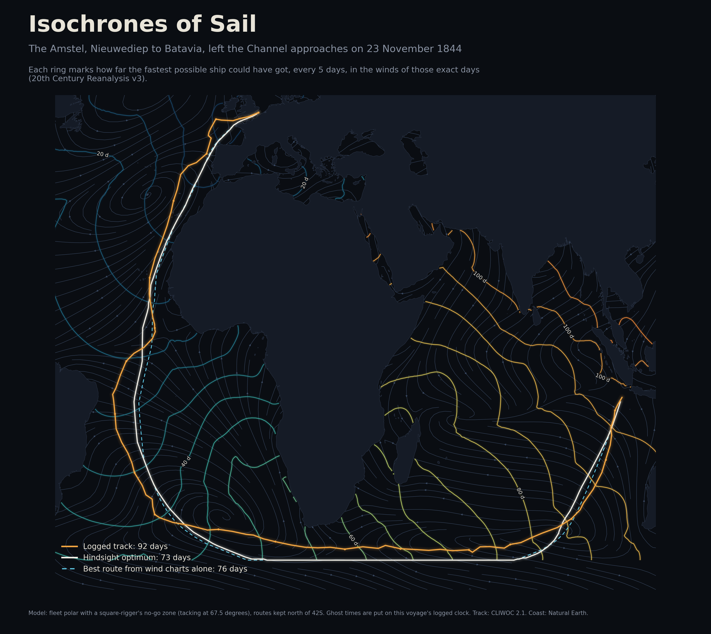
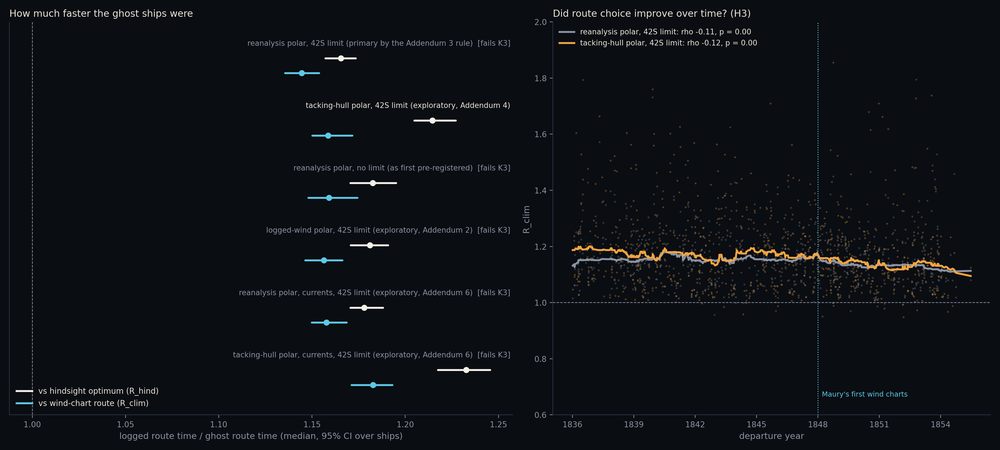
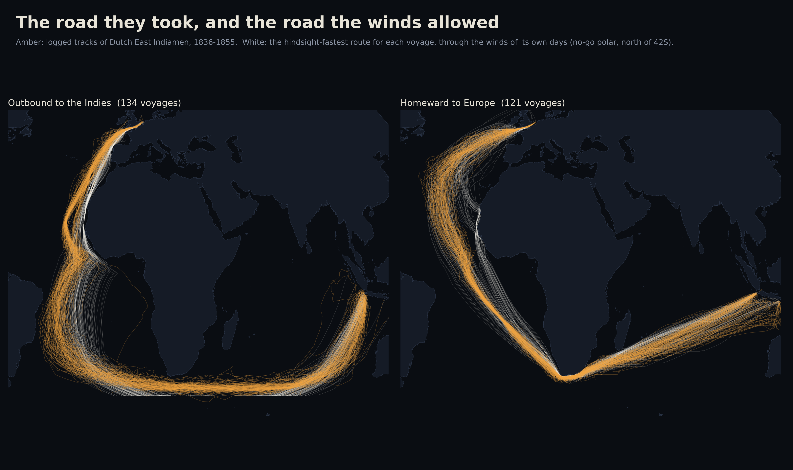
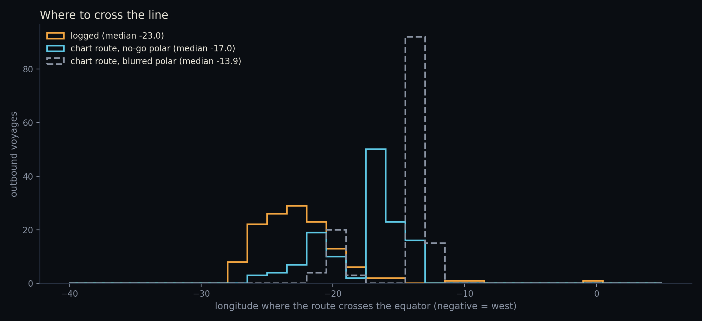
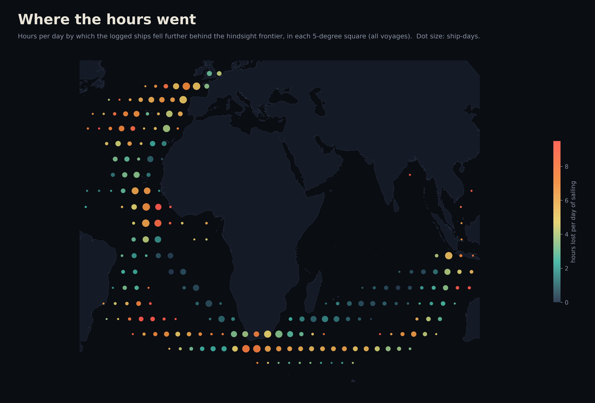
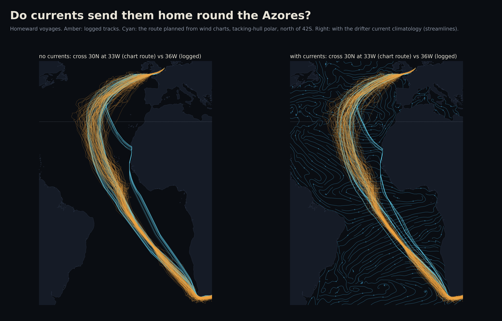
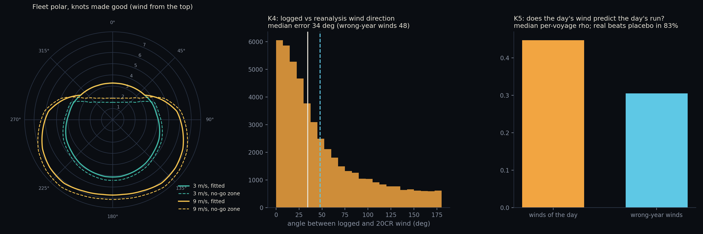
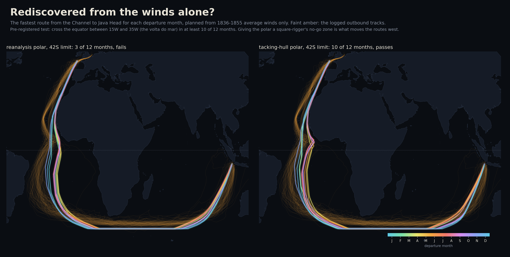

# Isochrones of Sail

How much time did sailing captains leave on the table, given the winds they actually met?



Ocean racers plan with isochrones: from the start, draw every place the boat could reach in 6
hours, then 12, then 18, until a ring touches the finish. This project points that method at
756 voyages of Dutch East Indiamen between 1836 and 1855. Each logbook (CLIWOC 2.1) gives a
noon position for every day at sea. The winds of those exact days come from the 20th Century
Reanalysis v3, which rebuilds the weather from surface pressure readings alone, so the sailors'
own wind notes stay independent of it.

Every voyage gets two ghost ships, both sailed through the same reanalysis winds with the same
fleet polar:

* **the hindsight optimum**: the fastest route through the real winds of those days, which no
  captain could have known in advance;
* **the wind-chart route**: the fastest route a planner could draw from perfect 1836-1855 average
  winds for that month, with no forecast. It is then sailed through the real winds.

The logged track is replayed through the same winds, so all three are timed the same way.

## Results

**The logged routes took about 15% longer than the best route a planner could have drawn from
good wind charts, sailed through the very same winds.** That is roughly 16-18 days on the
98-day outbound run to Java and 11 days on the 110-day run home. Every model agrees within four
percentage points, including the only one that passes the rediscovery check:

| Model | Passes K3 | R_clim (vs wind-chart route) | R_hind (vs hindsight optimum) | Outbound days lost to chart route |
|---|---|---|---|---|
| Reanalysis polar, 42S limit (primary, Addendum 3 rule) | no | **1.144** [1.136, 1.154] | 1.166 [1.157, 1.173] | 16.1 |
| Tacking-hull polar, 42S limit (exploratory) | **yes** (10/12) | **1.159** [1.150, 1.172] | 1.215 [1.205, 1.227] | 17.6 |
| Reanalysis polar, no limit (first pre-registration) | no | 1.159 [1.148, 1.174] | 1.183 [1.170, 1.195] | 19.2 |
| Logged-wind polar, 42S limit (exploratory) | no | 1.156 [1.146, 1.166] | 1.181 [1.171, 1.191] | 17.0 |
| Reanalysis polar, ocean currents, 42S limit (exploratory) | no (3/12) | 1.158 [1.150, 1.169] | 1.178 [1.171, 1.188] | 16.7 |
| Tacking-hull polar, ocean currents, 42S limit (exploratory) | no (7/12) | 1.183 [1.171, 1.193] | 1.233 [1.217, 1.245] | 19.1 |

Medians over 755 legs by 155 ships; 95% intervals resample whole ships. The replayed voyage
times track the logged durations closely (Spearman 0.92 across legs), so the model ranks fast
and slow passages much as the logbooks do.



**Hindsight adds almost nothing.** The hindsight optimum beats the wind-chart route by only
1.3% (primary) to 3.2% (tacking-hull). Nearly all of the gap is in the choice of route, not in
weather nobody could have known. The caveat: the 1840s reanalysis is an ensemble mean and
cannot see much day-to-day detail, even though it clearly carries some (K4, K5). So this bounds
the value of clairvoyance as seen by the reanalysis, not in the real ocean.

**Pre-registered hypotheses** (read from the primary model, which failed K3):

* H1, hindsight gap of 10-30%: **supported**, 16.6%.
* H2, captains at least as fast as the wind-chart route: **rejected**. They were 14.4% slower,
  and the whole interval lies above 1.
* H3, the gap narrows over 1836-1855: **supported, small**. Spearman rho -0.11 (p = 0.003); the
  median falls from 1.153 before 1845 to 1.125 after 1850 (difference -0.028, 95% CI -0.045 to
  -0.005). The same holds in all six models (rho -0.10 to -0.13). It fits the arrival of wind
  charts after 1848, but with no comparison group this cannot show that the charts caused it.

### Where the time went



The logged ships crossed the equator at a median 23.0W in every season. The chart routes cross
at 14-17W, depending on the polar. Within the fleet, though, ships that crossed further west
lost *less* time against their own chart route (exploratory: rho 0.25, p = 0.004 with the
tacking-hull polar; 0.14, p = 0.10 with the primary). That points at the model rather than the
captains: the traditional far-west crossing was not where the days went.



Measured as how fast each ship fell behind the hindsight frontier, losses run highest (about 10
hours a day) around the South Atlantic high at 25-30S and 10-25W, and on the first days of the
homeward run from eastern Java through the Bali Strait. The doldrums west of Africa (0-10N,
12-25W) cost 6-10 hours a day over thousands of ship-days. Losses are lowest in the southeast
trades of the Indian Ocean, where the logged tracks and the ghosts nearly coincide.



### What the model cannot see

* **Currents** were tested (next section): a monthly drifter climatology changes the routes little
  and moves them away from historical practice, not towards it.
* **Ice, cold and gales.** Unlimited routes dive to 50-54S. With the 42S limit the ghosts ride
  the limit across the Indian Ocean, a little south of the fleet's usual 38-40S, which flatters them.
* **Homeward North Atlantic.** With the blurred polars the homeward ghosts beat north along the
  African coast into the northeast trades, crossing 30N at a median 18-21W, while the logged ships
  swung west around the Azores high and crossed at 36W. The tacking-hull polar swings the chart
  routes out to 33W (hindsight routes 30W), close to the logbooks, though a minority still hug the
  coast. The fault is the polar's upwind blur, not the missing currents.
* **One fleet polar.** Ships differ in speed, but one scale on every speed cancels out of the ratios.
* **Smooth winds.** The ensemble mean damps strong winds (few ship-days above 10 m/s) and day-to-day
  detail, which shrinks the value of hindsight.

So the robust finding is the size of the gap between what was sailed and what a wind chart
recommends, about 15%. It holds across six models. What this cannot settle is whether captains
lacked that knowledge or followed conventional tracks for reasons a wind model cannot see.

### Ocean currents (exploratory, Addendum 6)

The first model ignored currents, the obvious suspect behind the K3 failure and the homeward
coast-hugging. `currents.py` adds the NOAA Global Drifter Program monthly climatology (Laurindo et
al. 2017, 0.25 degree). A ship steering to hold its course makes good sqrt(v^2 - c_cross^2) +
c_along over the ground. The search and the replay apply this in the same 20 km sub-steps, and the
polars are refitted on speed through the water (ground run minus the mean current along it).
Questions (a)-(d) were fixed in [PLAN.md](PLAN.md) before any voyage was routed with currents:

| | Reanalysis polar | | Tacking-hull polar | |
|---|---|---|---|---|
| | no currents | currents | no currents | currents |
| (a) chart route crosses the equator (outbound median; logged 23.0W) | 13.9W | 13.4W | 17.0W | 14.7W |
| (b) K3, months passing (need 10) | 3 | 3 | **10** | 7 |
| (c) homeward routes cross 30N, chart route (logged 36.3W) | 18.2W | 18.0W | 33.0W | 33.2W |
| (d) R_clim | 1.144 | 1.158 | 1.159 | 1.183 |

**Currents are not the missing piece.** They push the chart routes' equator crossing further *east*,
away from the logbooks (April-July departures by 1-4 degrees with the tacking-hull polar),
plausibly because the eastward equatorial countercurrent and Guinea Current favour a ship that
cuts the corner (not tested). As a result the tacking-hull model drops from passing K3 (10/12) to failing it (7/12).
They do nothing for the homeward run. The gap to the chart route grows slightly (by 1.4 to 2.4
points), and the replay ranks passages no better than before (Spearman 0.92 either way). What
moves the model towards historical practice is the square-rigger's no-go zone, not the currents.
Why the captains crossed the line so far west is still unexplained by winds or currents.



## Method

1. **Voyages.** `voyages.py` keeps one fix per day nearest local noon, drops single fixes that
   imply impossible runs, and splits logbooks into legs at any anchored day or any gap over 3
   days. Legs need 15+ days and 1,500+ km between ends; leg ends are trimmed to at least 0.3
   degrees from land. Duplicate logbooks of the same voyage are merged. That leaves 756 legs
   from 1836-1855 sailed by 155 ships: 134 outbound to the Indies, 121 homeward and 501 partial or
   other passages (Atlantic crossings, legs broken by a stop at the Cape or St Helena).
2. **Winds.** `fetch_winds.py` pulls the 20CRv3 ensemble-mean 10 m wind (6-hourly, about 1.4
   degrees) over 80W-130E, 62S-66N, plus the ensemble spread.
3. **Polar.** For each ship-day, speed made good from noon to noon against the reanalysis wind
   speed and the angle between course and wind, binned as medians over 50,525 ship-days. Course
   made good over a day already folds in tacking. One global factor (0.99) makes the median
   replayed voyage take exactly its logged time.
4. **Router.** `router.py` is a time-dependent shortest-path search on a 0.25 degree ocean grid with
   32 headings per node (about 11 degree resolution), written in numba. Its arrival-time field is
   the isochrone map. The same code runs on the real winds (hindsight optimum) or on a monthly
   table of expected speed per heading (wind-chart route).
5. **Replay.** Any track is sailed through the winds in 20 km steps; all three routes are timed this way.
6. **Ratios.** R_hind = replayed logged time / hindsight-optimum time, and R_clim = replayed logged
   time / wind-chart-route time. Confidence intervals resample whole ships.

## Known-answer checks

Pre-registered in [PLAN.md](PLAN.md) before any routing result existed.

| Check | What it tests | Result |
|---|---|---|
| K1 | In a uniform wind the isochrones match the polar's convex hull | pass, worst error 2.5% |
| K2 | Dead upwind and downwind times match distance over best velocity made good | pass, under 3% |
| K4 | Logged wind direction agrees better with the reanalysis on the same day than in other years | pass: median error 34 vs 48 degrees, real winds closer for 87% of voyages, p ~ 1e-99 |
| K5 | The day's reanalysis wind predicts the day's run better than wrong-year winds | pass: median per-voyage rho 0.45 vs 0.31, 83% of voyages, p ~ 1e-81 |
| K6 | Polar slower close-hauled than reaching, faster in more wind | pass: 3.4 vs 6.6 kn at 8 m/s |
| K3 | The wind-chart route from the Channel to Java Head rediscovers the volta do mar (crosses the equator 15-35W) and Brouwer's route (crosses 60E south of 30S) in 10 of 12 months | **fail** as pre-registered, see below |



### What K3 caught

The pre-registered model's chart routes did swing west of Africa, but crossed the line at
13.8-15.1W for March-October departures, while the logged ships crossed at a steady median
23.0W in every month. They also ran their easting at 50-54S, where no Dutch captain of the
period took a ship: 99% of logged legs never went south of 42S.

Two causes, both written down before any voyage was routed ([PLAN.md](PLAN.md) addenda 3 and 4):

* The model knows nothing of ice, cold or gales. Routes are now held north of 42S, the fleet's
  own envelope. This alone did not fix the equator crossing (3 of 12 months).
* The reanalysis wind directions are off by a median 34 degrees against the logs, so the fitted
  polar thinks a square-rigger can make 3.4-3.9 knots within 60 degrees of the wind. It cannot.
  A polar fitted to the sailors' own wind notes did no better (4 and 3 of 12). Replacing the
  close-hauled sector with what tacking at 67.5 degrees (six points) can make good moves the
  routes west: this "tacking-hull" model passes K3 in 10 of 12 months.



The rule fixed in Addendum 3 names the reanalysis polar with the 42S limit as the model that
answers the hypotheses, flagged because it failed K3. The tacking-hull model is the only one
that rediscovers the classic route, but it was added after the failure, so it is reported next
to the primary as exploratory, never instead of it.

## Run it

```bash
pip install -r requirements.txt
python src/run_all.py
python -m pytest tests
```

The wind download is about 80 files of 0.3-0.8 GB, subset and deleted one at a time (about an
hour). Routing takes 10-15 minutes per model on 16 cores, and about 50 with currents. See [DATA.md](DATA.md) for sources.
The interactive page is `docs/index.html` (serve the `docs` folder over HTTP).

## Files

* `src/voyages.py` logbooks to legs; `src/fetch_winds.py` reanalysis subset; `src/landmask.py` coast raster
* `src/polar.py` fleet polar; `src/climatology.py` monthly expected speeds; `src/router.py` search and replay
* `src/prepare.py` polar fit, calibration, checks K3-K6; `src/k3_variants.py`, `src/robust_logged.py`,
  `src/robust_hull.py`, `src/robust_currents.py` the addenda; `src/currents.py` the drifter climatology
* `src/route_legs.py` routes every voyage; `src/stats.py` H1-H3; `src/figures.py`, `src/docs_data.py` outputs
* `results/` checks, summaries and per-voyage tables; `figures/` posters; `docs/` interactive page
